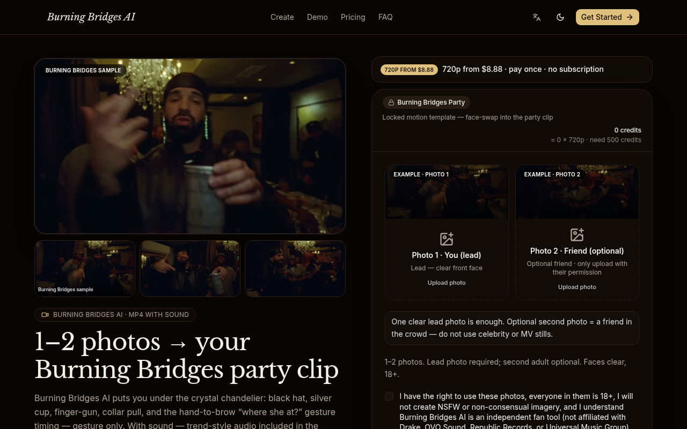
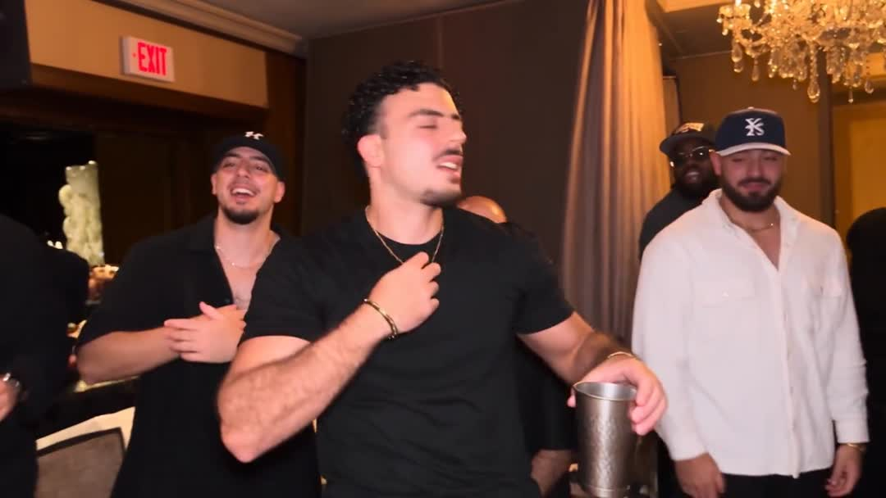
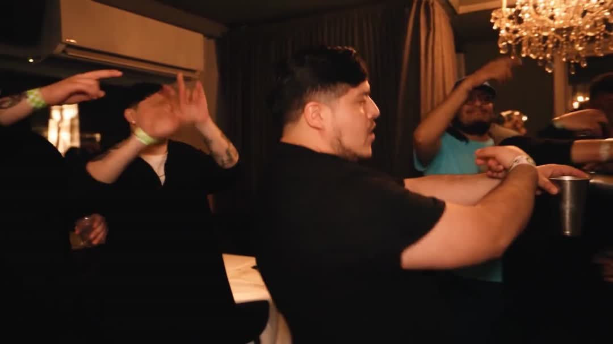

# Burning Bridges AI

  

  <strong>1～2 张照片 → 水晶吊灯包间派对手势模板短视频</strong> 
  付费成片约 15s · 竖屏友好 · 游客可付 
  起价 <b>$8.88</b> · 无订阅、无需注册

  
  

---

## 截图

  
  

---

## 怎么用

1. 打开 [burningbridgesvideoai.com](https://burningbridgesvideoai.com)
2. 上传 Photo 1（主角）；可选 Photo 2（包间朋友）
3. 勾选授权 → 选画幅 / 分辨率 → Create
4. Stripe 一次性积分包：Single **$8.88** / 3-pack **$16.99** / 10-pack **$39.90**（付费成片约 **15 秒**）

---

## 产品要点

- **锁定节拍**：入场吊灯包间 → 举银杯/手势 → 扯衣领嗨点 → 手搭眉骨张望收尾
- 付费生成约 **15 秒**；480p / 720p；画幅可选
- 音频为趋势风格生成轨，**非**官方商业歌曲
- 独立粉丝工具；亦可通过 burnbridgesai.video 访问

---

## 定价

| 套餐 | 价格 | 积分 |
|---|---|---|
| Single | $8.88 | 500 ≈ 1×720p |
| 3-pack | $16.99 | 1500 ≈ 3×720p |
| 10-pack | $39.90 | 5000 ≈ 10×720p |

一次性积分包，无订阅。英文简介：*Upload 1–2 photos → crystal chandelier lounge party gesture template → MP4 with trend-style audio.*

---

## Links

- 官网：https://burningbridgesvideoai.com
- GitHub Pages：https://Maynor996.github.io/burning-bridges-ai/
- 仓库：https://github.com/Maynor996/burning-bridges-ai

---

## License

Demo media for product showcase. Site © Maynor / xianyu110. Please only upload photos you own or have permission to use. Fan tool — unaffiliated with original artists, labels, or rights holders.
